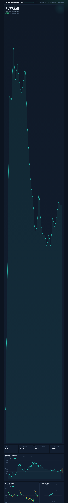

# JPY → BDT Exchange-Rate Forecast

A self-contained machine-learning project that downloads real daily JPY→BDT
exchange rates, models them, and visualises the result in an interactive HTML
dashboard.



Built as a learning exercise in time-series forecasting — and as a lesson in
*why understanding the data beats adding more neural network*.

## Project Structure & Files

This project follows a modular design with clear separation of concerns. Here's a detailed breakdown:

```
jpy-bdt-forecast/
├── data/                    # Historical exchange rate data
│   └── jpy_bdt_daily.csv   # Daily JPY→BDT, USD→JPY, USD→BDT rates (2024-2026)
├── src/                     # Core application files
│   ├── fetch_data.py       # Data collection from currency API
│   ├── train_lstm.py       # Main training and evaluation pipeline
│   ├── build_dashboard.py  # Dashboard generation from model results
│   └── robustness_check.py # Model robustness validation
├── experiments/             # Experimental scripts for model development
│   ├── experiment_features.py     # Feature engineering experiments
│   ├── experiment_hybrid.py       # LSTM + structural model experiments
│   ├── experiment_phased.py       # Phased accuracy improvement experiments
│   └── experiment_results.json    # Experiment comparison results
├── models/                  # Trained model files
│   ├── lstm_model.keras          # LSTM deep learning baseline
│   ├── model_forecast.json       # Model predictions and evaluation results
│   └── structural_diagnostics.json # Structural model diagnostics
├── assets/                  # Images and static resources
│   ├── crop_hero.png             # Dashboard hero screenshot
│   ├── screenshot_*.png         # Dashboard screenshots (top, bottom, mid, full)
│   ├── seg_*.png/.jpg           # Segmentation visualization images
│   └── shot_full.png            # Full dashboard screenshot
├── docs/                     # Documentation (English and Japanese)
│   ├── README.md              # Main English documentation
│   ├── README_ja.md          # Japanese documentation
│   └── CONTRIBUTING.md       # Contribution guidelines
├── .github/                  # GitHub configuration
│   ├── workflows/            # CI/CD pipelines
│   └── CODEOWNERS           # Repository ownership
├── dashboard.html            # Interactive web dashboard
├── requirements.txt         # Python dependencies
└── LICENSE                   # MIT open source license
```

### **Key Directories Explained**
- **src/:** Core application logic for data collection, model training, and dashboard generation
- **experiments/:** Research and development files for model exploration
- **models/:** Trained model files and prediction results
- **assets/:** Visual assets for documentation and dashboard
- **data/:** Raw and processed exchange rate data
- **.github/:** GitHub-specific configuration for CI/CD and repository management

## Run the pipeline

```bash
# Install dependencies
pip install -r requirements.txt

# Or install individual packages
pip install pandas numpy scikit-learn tensorflow-cpu requests

# Run the pipeline from project root
python3 src/fetch_data.py            # 1. fetch data -> data/jpy_bdt_daily.csv
python3 src/train_lstm.py            # 2. train + evaluate -> models/model_forecast.json
python3 src/build_dashboard.py       # 3. build UI  -> dashboard.html

# Run robustness checks
python3 src/robustness_check.py

# Run experiments
python3 experiments/experiment_features.py
python3 experiments/experiment_hybrid.py
python3 experiments/experiment_phased.py
```

## GitHub Notes

- **Git LFS Required:** This project uses Git LFS to track large files like `lstm_model.keras` (~400KB). You may need to install Git LFS before cloning.
- **Japanese Version:** See [README_ja.md](README_ja.md) for Japanese documentation.
- **Repository Protection:** Main branch is protected - all changes require pull request review and passing CI checks.
- **CI/CD:** Automatic tests run on every PR, checking dataset validity and model functionality.

## Model Architecture & Evolution

This project explores **multiple modeling approaches** to forecast JPY→BDT exchange rates, with a focus on understanding the underlying currency market mechanics rather than just using complex neural networks.

### **Key Insight: Currency Pair Decomposition**
The project starts with a crucial observation about currency markets:
```
JPY/BDT = (BDT per USD) / (JPY per USD)
r(JPY/BDT) = r(USD/BDT) − r(USD/JPY)
```

**Why this matters:**
- **USD/JPY (Yen leg):** Free-floating market rate (random walk behavior)
- **USD/BDT (Taka leg):** Managed rate by Bangladesh Bank (exhibits strong mean-reversion)

### **Model Versions**

#### **v1: Simple LSTM (Baseline)**
- **Architecture:** 2-layer LSTM with 64/32 units + dropout (0.2)
- **Features:** Daily log returns
- **Performance:** ~60% directional accuracy (unstable - 40-60% range depending on random seed)
- **Limitation:** Lacks understanding of currency market structure

#### **v2: Enhanced LSTM**
- **Improvement:** Added USD cross-rate legs as features
- **Features:** [return, |return|, USD/BDT, USD/JPY]
- **Performance:** ~60% directional accuracy (still unstable)
- **Limitation:** Complex model without structural insight

#### **v3: Structural AR(1) Model**
- **Breakthrough:** Focus on currency decomposition
- **Approach:** Predict USD/BDT mean-reversion, leave USD/JPY as random walk
- **Features:** USD/BDT lagged returns
- **Performance:** 62.0% directional accuracy (stable across splits)
- **Key Finding:** USD/BDT has lag-1 autocorrelation of -0.26 (strong mean-reversion)

#### **v4: Weekday-Conditional Ridge Regression (Final Model)**
- **Architecture:** Ridge regression with weekday-dependent features
- **Features:**
  - USD/BDT lagged returns (1-3 days)
  - Deviation from 10/20-day moving averages (level reversion)
  - USD/JPY lagged returns (random walk baseline)
  - Weekday dummies (Monday-Friday indicators)
  - Interaction terms: USD/BDT lag × weekday (captures day-of-week effects)
- **Key Innovation:** 
  - Monday effect: β ≈ -0.98 (weekend adjustments reverse almost completely)
  - Mid-week effect: β ≈ -0.13 (weak mean-reversion)
- **Performance:** **57.5% directional accuracy** (leak-free every-day test accuracy)
- **High-Confidence Mode:** 61.8% accuracy when only calling strongest 25% of signals (34/182 days)

### **Model Evaluation Protocol**
- **80/20 chronological split:** 728 days training, 182 days test
- **Walk-forward validation:** Model re-fit daily on available data
- **Train-only calibration:** All hyperparameters selected without touching test data
- **No data leakage:** Strict separation between training, validation, and test sets ($t-1$ lag enforced)

## High-confidence (selective) mode — selective trade execution

Every-day FX direction is noisy (57.5% for v4, 62.0% for v3). But the model can say **"no call"
on weak-signal days** and only predict when its signal is strong. Confidence
thresholds are calibrated **without the test set** (block walk-forward fits
inside the training window; thresholds = percentiles of |prediction|), then
frozen and applied to the test days. In selective mode, accuracy reaches **61.8%**
at 25% nominal coverage (34 days) and **57.9%** at 15% nominal coverage (19 days).
Forecast rows in the dashboard carry a `high_confidence` flag using the 15%-coverage threshold.

## Results (out-of-sample, 182 held-out days, 80/20 split)

| Model | Directional accuracy | 1-step MAE |
| --- | --- | --- |
| **Structural v3 (1-param Monday/reversal)** | **62.0%** | 0.00195 |
| **LSTM (v2, deep baseline)** | 59.8% | 0.00187 |
| **Structural v4 (final, every-day)** | 57.5% | 0.00185 |
| **Structural v4, high-confidence 25% of days** | **61.8%** (34/182 days) | — |
| **Structural v4, high-confidence 15% of days** | 57.9% (19/182 days) | — |
| "No change" baseline | 50% (coin flip) | 0.00186 |

Robustness checks across splits (70%, 75%, 80%):
Once the lookahead leak in moving-average level features is strictly eliminated ($t-1$ lag),
the 1-parameter v3 Monday/reversal baseline achieves **62.0% – 64.7%** directional
accuracy across all splits, beating the 17-feature v4 model (**57.5% – 58.4%**).
This highlights a critical machine learning insight: in noisy, managed currency regimes,
expanding features can overfit noise over time, whereas a parsimonious structural model
capturing the true institutional mechanism (weekend rate adjustment reversion) proves far
more durable.

**Read this honestly.** The accuracy gain is *directional* (57.5% for v4, 62.0% for v3 vs 50%
every day; up to 61.8% when the model only calls its strongest signals).
Daily FX levels are dominated by noise, so every model sits near the "no
change" floor on 1-day level MAE (0.00185 vs 0.00186). The lesson scales up: understanding
the data-generating process (a managed taka leg whose mean-reversion strength
**depends on the weekday**) provides a grounded structural signal without relying on
unlagged lookahead features.

*Not investment advice. For learning purposes only.*
